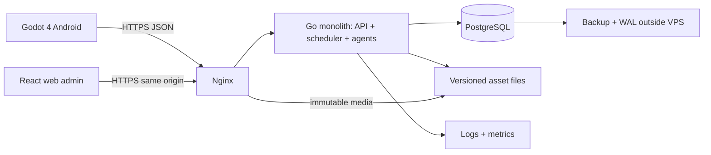

# Архитектура A: модульный монолит

Статус: проектная инженерная база этапа 3; не реализовано. Продукт: DEC-001. Изменение существенных игровых решений требует заказчика; внутренние детали уточняются в задаче с записью ENG.

## Границы модулей

| Модуль Go | Владеет | Ключевое ограничение |
|---|---|---|
| identity | аккаунты, сессии, роли, VIP entitlement | Нет прав, вычисляемых клиентом |
| world/catalog | города, товары, рецепты, коэффициенты/версии | Ссылочная целостность, effective_at |
| ledger | счета, резервы, проводки, стартовые гранты | Только атомарные команды; история неизменяема |
| company/enterprise | компании, аренда, линии, работники, кредит | Владение и оплачиваемые лимиты |
| production/inventory | партии, вместимость, порча, выпуск | Нельзя отрицательный запас или повторный выпуск |
| market/contracts/logistics | заявки, сделки, простые договоры, доставки | Резерв до исполнения, price-time priority |
| demand/external | бюджет населения, лимитированные системные поставки | Открытая эмиссия/внешний сектор |
| agents | состояние/память/цели алгоритмических владельцев | Те же публичные команды и правила |
| admin/assets/events | специализированные формы/API, манифесты/события, аудит | Нет прямого SQL-редактора или исполнения файлов |
| runtime | расписание, outbox, снимки, метрики | Повтор безопасен; один владелец расчёта мира |

Это пакеты одной кодовой базы, не микросервисы. Начальная Compose-инсталляция: nginx, server, postgres; backup/метрики — простые обслуживающие процессы по задаче. API и scheduler работают из одного серверного бинарника; защищённый блокировкой PostgreSQL планировщик допускает одного активного обработчика. Разделение процессов допускается позже по измеренной нагрузке, без вынесения бухгалтерии в распределённые транзакции.

## Технологии и версии

Godot 4/GDScript, Compatibility renderer для 2D; Go stdlib HTTP + pgx, PostgreSQL18, React+TypeScript+Vite для админки; Ubuntu24.04 LTS, Compose/Nginx. Выбор Go обусловлен транзакционными командами, конкурентными тестами, простой поставкой одного бинарника. React даёт удобные специализированные формы; тяжёлые конструкторы и отдельный Node production backend не нужны: Vite собирает статику, её отдаёт Nginx.

Наблюдение официальных релизов этапа 2: Godot 4.7.2-stable и Go1.27.4. Это кандидаты toolchain; F00 проверяет checksum, стабильность и фиксирует точные версии/templates/SDK/Node/npm/pgx/образов/Actions. В текущей среде Godot 4.6.3, Java21; рабочий Go SDK/Android SDK не подтверждены. Не подменять выбранный релиз тем, что случайно установлен. Документация Godot Android рекомендует JDK17, SDK35/build-tools35.0.1; конкретный набор сверяется с закреплённой версией. AAB и требования магазина — отдельная release-задача; срез требует APK.

## Сеть и доверие

API /api/v1 для Android, /admin/api/v1 для админки. Клиент не использует Godot high-level RPC как протокол Go: используется HTTPS через HTTPRequest. Сначала polling по cursor, затем обычный WebSocket для уведомлений; оба возвращают один серверный результат. WSS после commit отправляет сохранённый event ID; пропуск восполняется через snapshot/events.

API не принимает готовый balance, цену исполнения, роль, время партии или прибыль. Допустимы намерения и пользовательская цена заявки. Сервер валидирует права и ограничения. JSON int64 — десятичные строки, чтобы React/JS не терял точность. Идемпотентность, ошибки и версии: [API](api.md).

## Масштаб и эксплуатация

Срез проектируется на 20–50 тестовых аккаунтов, последующая альфа — цель 100–300 одновременных пользователей, подтверждаемая нагрузкой, а не названием VPS. Начальный sizing-кандидат: 4 vCPU/8 GB RAM/SSD с запасом и off-host backup; закупка/доступ не выполнены. Сначала профилирование запросов/циклов, затем индексы/пулы, и только потом расширение архитектуры.

Связанные документы: [данные](data-model.md), [время](time-sync.md), [безопасность](security.md), [эксплуатация](../operations/deployment.md). Нет Redis, Kafka, Kubernetes, блокчейна и платного LLM-контура в первом срезе.
